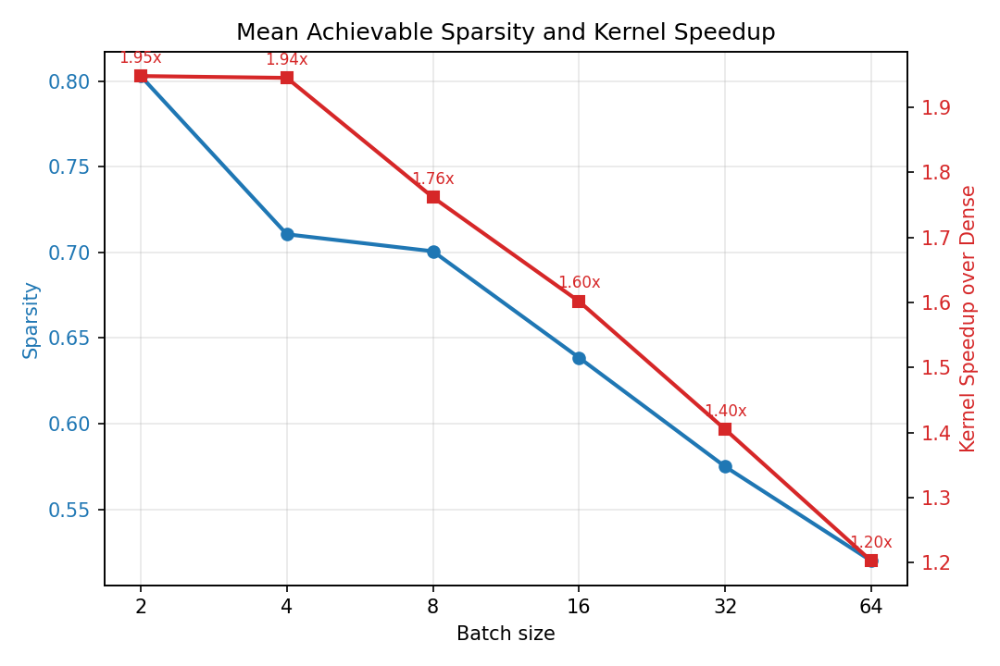

# Towards Batched Activation Sparsity in LLM Decoding

Code and results for the master's thesis **“Towards Batched Activation
Sparsity in LLM Decoding”** (Junseo Lee, Seoul National University, 2026).

Thesis: [official full text at Seoul National University dCollection](https://dcollection.snu.ac.kr/public_resource/pdf/000000199763_20261107004756.pdf).

## Overview

This work studies how much activation sparsity remains when every sequence in
a decoding batch shares one hardware-friendly block mask. The artifact contains
the per-step oracle search, a 64-channel block-sparse GEMM implementation,
kernel measurements, sensitivity experiments, and practical online baselines.

## Setup

| Component | Setting |
|---|---|
| GPU | **NVIDIA A100X 80GB** |
| Model | Llama 2 7B |
| Primary dataset | Alpaca |
| Sparsity structure | Batch-shared blocks of 64 activation channels |
| Quality budget | Per-step NLL of batch-size-1 TEAL at 50% sparsity |
| Kernel baseline | Dense GEMM through cuBLAS |

## Main Results

Each point averages independently evaluated per-step oracle maps over five
batch groups and the first 11 decoding steps.

| Batch size | Per-step oracle mean block sparsity | Kernel-level speedup upper bound |
|---:|---:|---:|
| 2 | 0.803 | 1.948x |
| 16 | 0.638 | 1.602x |
| 64 | 0.520 | 1.203x |

At each evaluated step, only that decoding position is sparsified; the oracle
does not perform a sequential sparse rollout. The speedups therefore describe
the kernel-level upper bound associated with the per-step oracle maps, not
end-to-end serving speedup. Chapter 5 evaluates practical online selection and
its runtime overhead separately.



## Artifact Contents

```text
figures/     figures used in Chapter 4 and Appendix A
results/     compact raw JSON/CSV snapshots behind the reported numbers
scripts/     oracle, kernel, heuristic, and plotting programs
kernels/     Triton block-sparse GEMM implementation
docs/        reproduction protocol and artifact scope
```

## Reproducing the Figures

This path is CPU-only and uses the committed result snapshots.

```bash
python -m venv .venv
source .venv/bin/activate
pip install -r requirements-plot.txt
python scripts/plot_paper_results.py
```

Generated files are written to `reproduced_figures/`. The script verifies the
reported batch-16 and batch-64 values against the committed measurements.

## Reproducing the GPU Experiments

The GPU experiments require Llama 2 access and TEAL calibration histograms.
See [docs/REPRODUCING.md](docs/REPRODUCING.md) for the oracle sweep, kernel
configuration search, profiling, and practical online benchmark. Reprofiling is
required when the GPU model or relevant CUDA/PyTorch/Triton stack changes.

Detailed artifact scope and limitations are documented in
[docs/ARTIFACT_MANIFEST.md](docs/ARTIFACT_MANIFEST.md).

## Citation

Please use [CITATION.cff](CITATION.cff), or:

```bibtex
@mastersthesis{lee2026batchedactivation,
  author = {Junseo Lee},
  title = {Towards Batched Activation Sparsity in LLM Decoding},
  school = {Seoul National University},
  year = {2026},
  month = {August}
}
```

## License and Third-Party Components

Artifact code is released under the MIT License. The thesis PDF is available
from the institutional repository linked above. The kernel and experiment
code builds on TEAL; its MIT license is preserved in
`third_party/TEAL_LICENSE`. Model weights and datasets are not redistributed
and remain subject to their own licenses and access terms.
